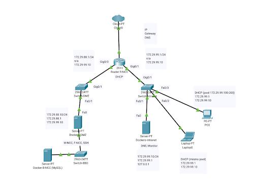

# 🚀 Projecte P0.0: Desplegament d’Infraestructura i Serveis

> **Mòdul:** MP14 - Projecte Intermodular d'Administració de Sistemes Informàtics en Xarxa (ASIX)
> **Grup:** `P0.0-ASIXc2B-G07`
> **Curs:** 2025-2026

---

## 👥 Integrants de l'Equip

| Nom i Cognoms | Usuari GitHub | Rol Principal |
| :--- | :--- | :--- |
| **Dídac Vázquez** | [DidacVazquez](https://github.com/ITB2526-DidacVazquez) | Coordinador Git / Administrador de Xarxa |
| **Nom Integrant 2** | [LiamTebar](https://github.com/) | Administrador de Serveis (DMZ / Intranet) |
| **Nom Integrant 3** | [GerardRomo](https://github.com/) | Desenvolupador i Documentació / PRL |

---

## 📌 Descripció del Projecte

Aquest projecte té com a objectiu el disseny, configuració i desplegament d'una **infraestructura de xarxa multicapa** per suportar una aplicació web i serveis de xarxa (Web, FTP, SSH, BBDD, DHCP, DNS i monitor).

- **Sprint 1 (MVP):** tots els serveis en contenidors Docker dins d'una sola VM ([guia del MVP](docs/02-admin/MVP_sprint1_infraestructura-config.md)).
- **Arquitectura final:** router `R-NCC` amb DMZ, Intranet i NAT, i la base de dades en una xarxa aïllada ([arquitectura i justificació](docs/02-admin/arquitectura.md)).

---

## 🗺️ Mapa de xarxa



| Equip | Xarxa | Adreça IP | Gateway | DNS | Serveis |
| :--- | :--- | :--- | :--- | :--- | :--- |
| **`R-NCC`** (router) | DMZ / Intranet / NAT | `172.29.88.1` · `172.29.99.1` · DHCP | — | `172.29.99.10` | Enrutament, DHCP, NAT |
| **`Dockers-DMZ`** | DMZ | `172.29.88.10/24` | `172.29.88.1` | `172.29.99.10` | Web (`W-NCC`), FTP (`F-NCC`), SSH |
| **`Docker-B-NCC`** | BBDD (aïllada) | `172.29.89.10/24` | — | — | MySQL (`B-NCC`) |
| **`Dockers-Intranet`** | Intranet | `172.29.99.10/24` | `172.29.99.1` | `127.0.0.1` | DNS (`D-NCC`), Monitor |
| **Clients** (Windows i Linux) | Intranet | DHCP `172.29.99.100-200` | `172.29.99.1` | `172.29.99.10` | — |

---

## 📂 Estructura de la Documentació

| Document | Contingut |
| :--- | :--- |
| [00 · Gestió (ProofHub)](docs/00-gestio/proofhub.md) | Dinàmica de treball, repartiment de tasques i fotos de cada sprint |
| [01 · Estudi previ](docs/01-analisi/estudi_previ.md) | Requisits, planificació en sprints (ProofHub) i justificació tecnològica |
| [02 · Arquitectura](docs/02-admin/arquitectura.md) | Diagrama de xarxa, inventari d'equips, adreçament IP i noms DNS |
| [02 · Guia MVP Sprint 1](docs/02-admin/MVP_sprint1_infraestructura-config.md) | Creació de VMs, xarxa, enrutament i Docker pas a pas |
| [02 · Serveis](docs/02-admin/serveis.md) | SSH, Web, BBDD + càrrega CSV, DHCP, DNS, FTP, app, monitor i NAT |
| [02 · Flux de treball Git](docs/02-admin/git_workflow.md) | Clau SSH, ordres Git i pujada a producció |
| [03 · Manual d'usuari](docs/03-client/manual_usuari.md) | Configuració dels clients i accés als serveis |
| [04 · Pla de riscos](docs/04-prl/pla_riscos.md) | PRL, riscos tècnics i còpies de seguretat |
| [05 · Pla de proves](docs/05-proves/test_plan.md) | Banc de proves i registre d'execució |

```text
P0.0-ASIXc2B-G07/
├── README.md                      # Presentació i índex principal del projecte
├── docs/
│   ├── 00-gestio/                 # Gestió del projecte: ProofHub, sprints i retrospectives
│   │   ├── proofhub.md
│   │   └── img/                   # Fotos del tauler a l'inici i al final de cada sprint
│   ├── img/                       # Mapa de xarxa (Packet Tracer)
│   ├── 01-analisi/                # Estudi previ i justificació tecnològica (RA1)
│   │   └── estudi_previ.md
│   ├── 02-admin/                  # Manuals de configuració d'administrador (RA3, RA4)
│   │   ├── arquitectura.md        # Mapa de xarxa, IPs i justificació de decisions
│   │   ├── MVP_sprint1_infraestructura-config.md  # Guia de desplegament del MVP
│   │   ├── serveis.md             # Guia de serveis (SSH, Web, BBDD, DHCP, DNS, FTP...)
│   │   └── git_workflow.md        # Procediment i comandes del flux de treball Git
│   ├── 03-client/                 # Manuals d'usuari i configuració de clients (RA3, RA4)
│   │   └── manual_usuari.md
│   ├── 04-prl/                    # Pla de Prevenció de Riscos Laborals i Tècnics (RA3)
│   │   └── pla_riscos.md
│   └── 05-proves/                 # Pla de qualitat i banc de proves (RA2)
│       └── test_plan.md
└── src/                           # Codi font del projecte
    ├── docker-compose.yml         # Fitxer de desplegament dels contenidors Docker
    ├── .env.example               # Variables d'entorn necessàries (sense valors reals)
    ├── bbdd/                      # Scripts d'estructura i càrrega de dades SQL
    ├── dns/                       # named.conf i fitxer de zona asix.local
    ├── app/                       # Codi de l'aplicació Web
    └── scripts/                   # Scripts d'automatització
```

---

## 🔑 Accés per a la correcció

Tots els sistemes i serveis tenen l'usuari **`bchecker`** amb contrasenya **`bchecker121`**.
