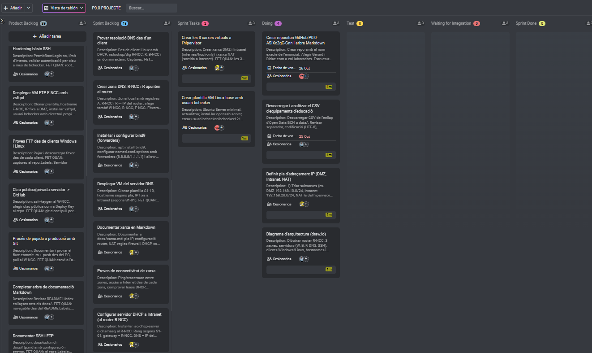
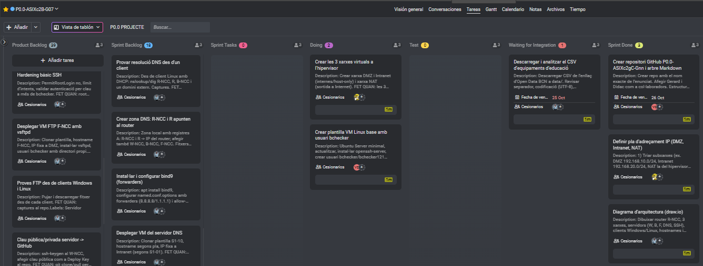
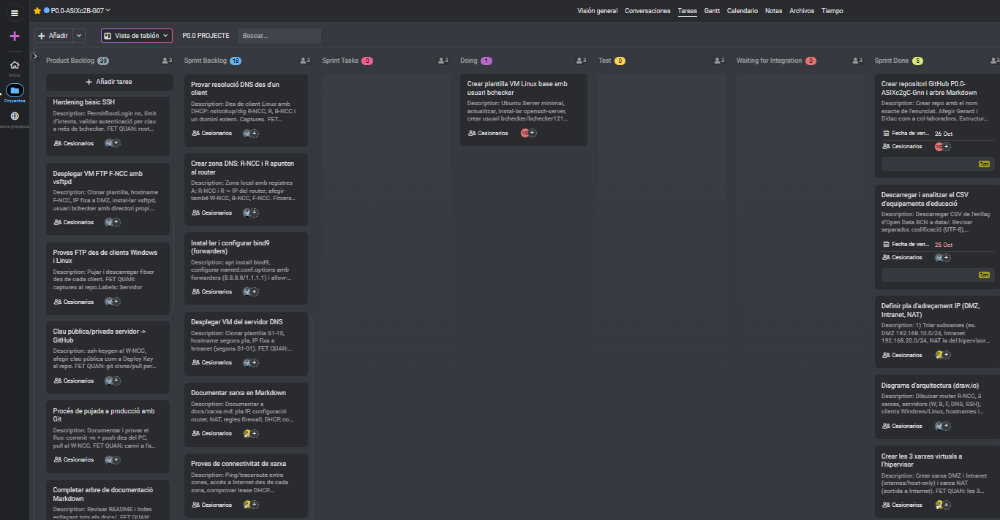

# 📅 Gestió del projecte (ProofHub)

> Com organitzem la feina en grup: eines, repartiment de tasques i seguiment de cada sprint.
> Projecte al ProofHub: **`P0.0-ASIXc2B-G07`**

## Índex

1. [Eines i dinàmica de treball](#1-eines-i-dinàmica-de-treball)
2. [Com fem servir el ProofHub](#2-com-fem-servir-el-proofhub)
3. [Rols de l'equip](#3-rols-de-lequip)
4. [Sprint 1](#4-sprint-1)
5. [Sprint 2](#5-sprint-2)
6. [Sprint 3](#6-sprint-3)

---

## 1. Eines i dinàmica de treball

| Eina | Per a què la fem servir |
| :--- | :--- |
| **ProofHub** | Backlog, repartiment de tasques, dates i seguiment de cada sprint |
| **GitHub** | Documentació, fitxers de configuració i historial de canvis |
| **Packet Tracer / draw.io** | Disseny del mapa de xarxa abans de muntar-lo |
| **IsardVDI** | Màquines virtuals on despleguem la infraestructura real |
| **Google Meet** | Reunions de seguiment quan no coincidim a classe |

**Dinàmica:**

- Sprints **quinzenals** de **10 h** (5 h per setmana).
- **Inici de sprint:** passem tasques del *Product Backlog* al *Sprint Backlog*, les repartim i fem la **foto inicial** del tauler.
- **Cada sessió de classe:** 5 minuts per explicar què ha fet cadascú, què farà i si està bloquejat.
- **Final de sprint:** revisem què s'ha acabat, fem la **foto final** del tauler i les tasques no acabades tornen al backlog.
- Cada tasca acabada ha de tenir la seva documentació pujada a GitHub.

## 2. Com fem servir el ProofHub

Treballem amb la **vista de tauler** (*Vista de tablón*) de *Tareas*, organitzada com un tauler Scrum. Cada tasca avança d'esquerra a dreta:

| Columna | Què vol dir |
| :--- | :--- |
| **Product Backlog** | Totes les tasques del projecte que encara no hem planificat |
| **Sprint Backlog** | Tasques que hem triat per fer en aquest sprint |
| **Sprint Tasks** | Tasques del sprint repartides i a punt per començar |
| **Doing** | Algú hi està treballant ara mateix |
| **Test** | Feta, però pendent de provar |
| **Waiting for Integration** | Provada, pendent d'integrar amb la resta (repositori, altres serveis...) |
| **Sprint Done** | Acabada i documentada |

**Cada tasca té:**

- un **responsable** (*Cesionarios*), perquè quedi clar qui fa què;
- una **descripció** amb els passos a seguir;
- un criteri **"FET QUAN"**, que diu exactament quan es considera acabada (per exemple: *"captures al repo"*);
- una **data de venciment** quan cal tenir-la en una data concreta;
- **etiquetes** per tipus de feina (*Servidor*, *Xarxa*, *Documentació*...).

**Fotos del sprint:** fem una captura del tauler el primer i l'últim dia del sprint (i alguna entremig) i la guardem a [`img/`](img/) amb el nom `sprintN-inici.png`, `sprintN-seguiment.png` i `sprintN-final.png`.

## 3. Rols de l'equip

| Membre | Rol principal | Responsabilitats |
| :--- | :--- | :--- |
| **Dídac Vázquez** | Coordinador Git / Xarxa | Repositori, router, enrutament, NAT, DHCP |
| **Integrant 2** | Serveis | DNS, Web, FTP, BBDD, Docker |
| **Integrant 3** | Documentació / PRL | Markdown, pla de riscos, pla de proves, ProofHub |

> Tots els membres documenten les tasques que fan, no només el responsable de documentació.

---

## 4. Sprint 1

**Objectiu:** preparar la base del projecte: repositori, pla d'adreçament, diagrama, xarxes virtuals i plantilla de VM.

| Tasca (ProofHub) | Responsable | FET QUAN | Estat final |
| :--- | :--- | :--- | :-: |
| Crear repositori GitHub `P0.0-ASIXc2gC-Gnn` i arbre Markdown | | Repo amb el nom de l'enunciat, col·laboradors afegits i estructura de carpetes | ✅ |
| Descarregar i analitzar el CSV d'equipaments d'educació | | CSV a `data/`, revisats separador i codificació (UTF-8) | ✅ |
| Definir pla d'adreçament IP (DMZ, Intranet, NAT) | | Subxarxes triades i documentades | ✅ |
| Diagrama d'arquitectura | | Router `R-NCC`, 3 xarxes, servidors, clients i hostnames dibuixats | ✅ |
| Crear les 3 xarxes virtuals a l'hipervisor | | Xarxes DMZ, Intranet i NAT creades | ✅ |
| Crear plantilla VM Linux base amb usuari `bchecker` | | Ubuntu Server actualitzat, `openssh-server` i usuari `bchecker` creats | ⏳ En curs |

### Fotos del tauler

**Inici del sprint:** 2 tasques a *Sprint Tasks*, 4 a *Doing* i cap acabada.

**Seguiment:** 3 tasques acabades, el CSV pendent d'integrar i 2 tasques en curs.

**Final del sprint:** 5 tasques acabades. La plantilla de VM continua en curs i passa al sprint següent.

### Reunions

**Reunió de seguiment** per videotrucada (Google Meet), amb els tres membres de l'equip: revisió de l'estat del MVP i repartiment de les tasques pendents.

| Data | Assistents | Temes | Acords |
| :--- | :--- | :--- | :--- |
| | Dídac, Gerard, Liam | Estat del MVP i proves des dels clients | |

**Retrospectiva:**

- ✅ Ha anat bé:
- ⚠️ A millorar:
- 🔧 Incidències: conflicte d'IPs entre router i client; ruta per defecte duplicada per la xarxa `Default` d'IsardVDI; error SSH/LDAP en fer `git push`.

---

## 5. Sprint 2

**Objectiu:** DNS, DHCP i proves de connectivitat. Són les tasques que ja tenim a la columna *Sprint Backlog*.

| Tasca (ProofHub) | Responsable | Estat final |
| :--- | :--- | :-: |
| Crear plantilla VM Linux base amb usuari `bchecker` *(ve del Sprint 1)* | | |
| Desplegar VM del servidor DNS | | |
| Instal·lar i configurar bind9 (*forwarders*) | | |
| Crear zona DNS: `R-NCC` i `R` apunten al router | | |
| Provar resolució DNS des d'un client | | |
| Configurar servidor DHCP a la Intranet (al router `R-NCC`) | | |
| Proves de connectivitat de xarxa | | |
| Documentar xarxa en Markdown | | |

| Inici del sprint | Final del sprint |
| :-: | :-: |
|  |  |

**Retrospectiva:**

- ✅ Ha anat bé:
- ⚠️ A millorar:
- 🔧 Incidències:

---

## 6. Sprint 3

**Objectiu:** FTP, SSH, Git, aplicació web, proves i lliurament. Previsió amb tasques del *Product Backlog*:

| Tasca (ProofHub) | Responsable | Estat final |
| :--- | :--- | :-: |
| Desplegar VM FTP `F-NCC` amb vsftpd | | |
| Proves FTP des de clients Windows i Linux | | |
| Hardening bàsic SSH | | |
| Clau pública/privada servidor → GitHub | | |
| Procés de pujada a producció amb Git | | |
| Documentar SSH i FTP | | |
| Completar arbre de documentació Markdown | | |

| Inici del sprint | Final del sprint |
| :-: | :-: |
|  |  |

**Retrospectiva:**

- ✅ Ha anat bé:
- ⚠️ A millorar:
- 🔧 Incidències:
