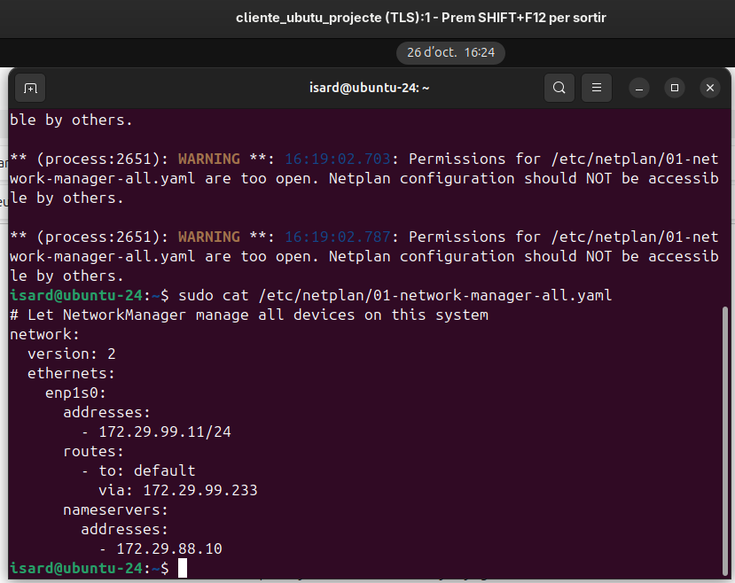
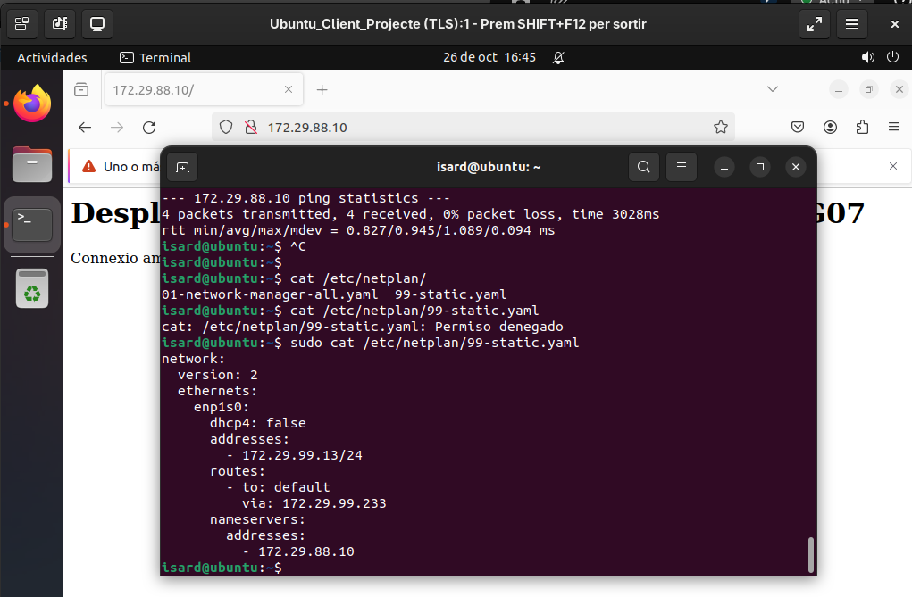
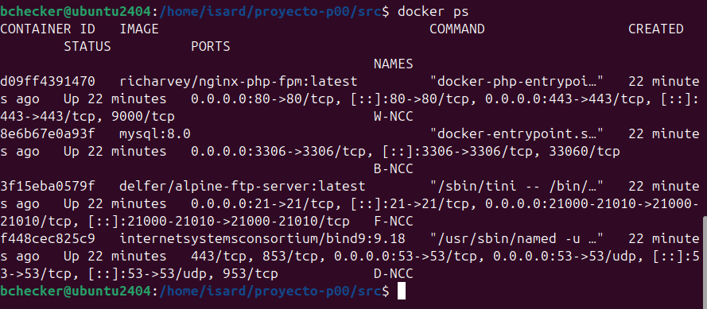
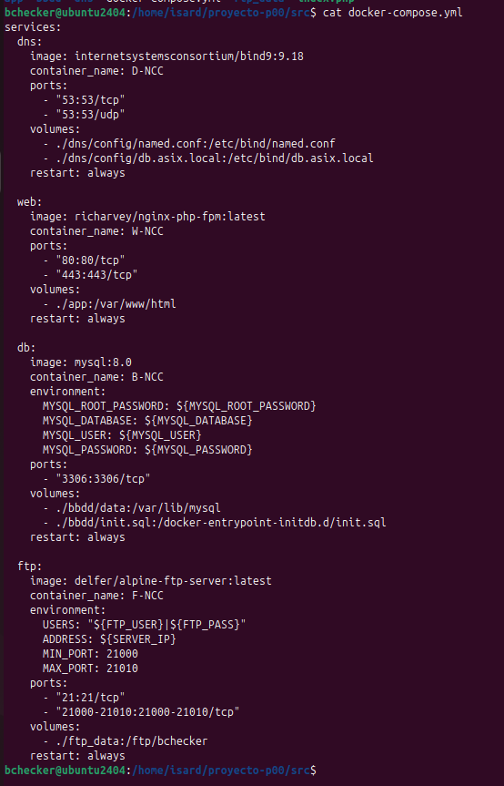
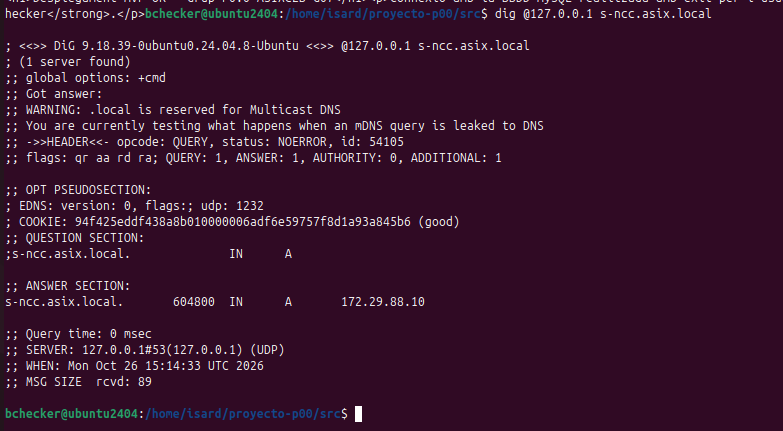
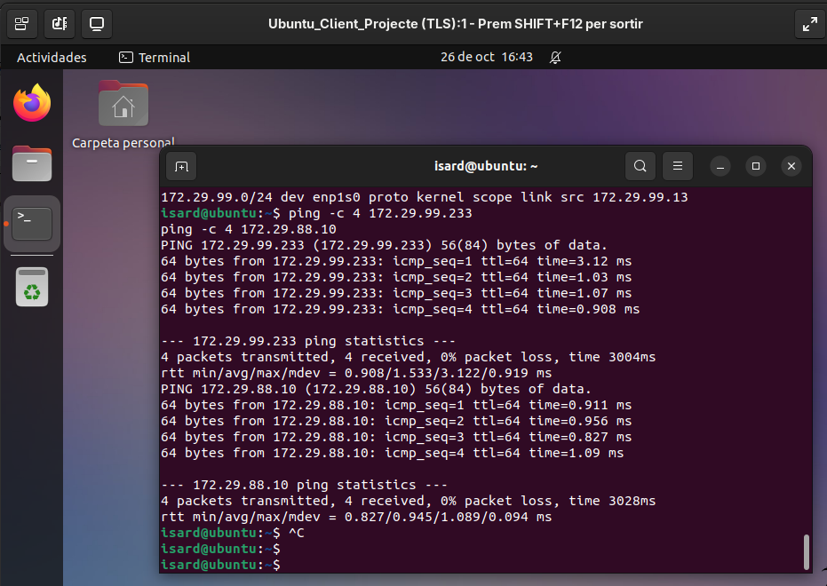
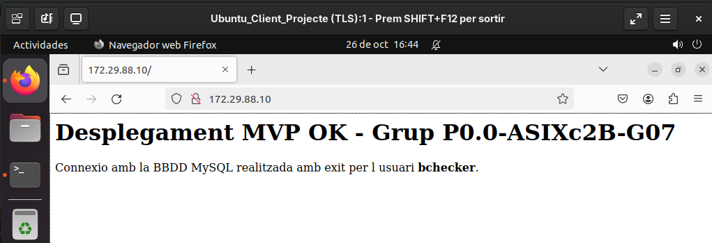
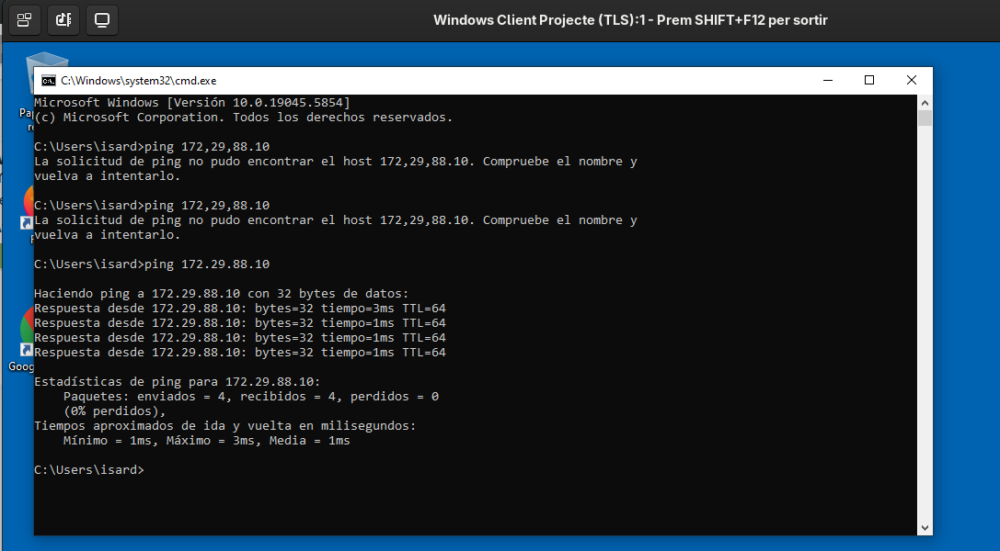
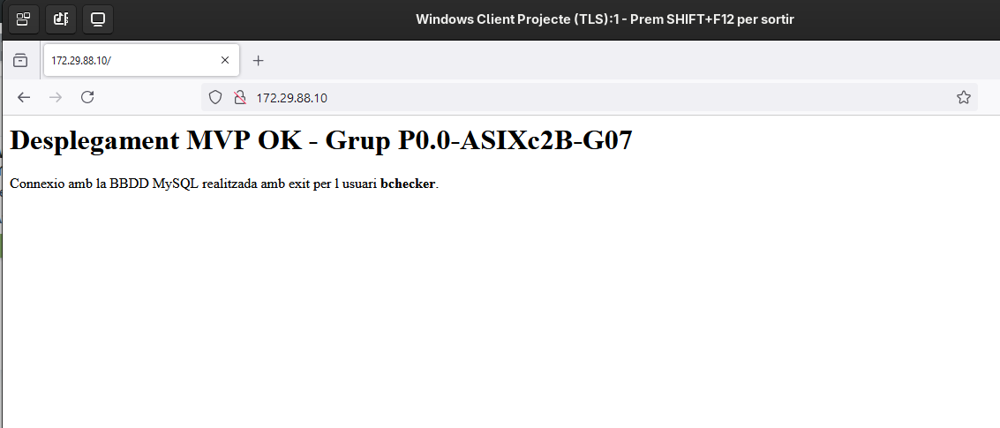

# 🛠️ Guia de Desplegament de la Infraestructura i MVP (Sprint 1)

> **Mòdul:** MP14 – Projecte Intermodular ASIX
> **Repositori:** `P0.0-ASIXc2B-G07`
> **Responsable:** Dídac Vázquez (Coordinador Git i Administrador de Xarxa)

> ℹ️ Aquesta guia descriu el **MVP del Sprint 1**, amb tots els serveis en una sola VM. L'arquitectura final (serveis repartits en DMZ, Intranet i xarxa de BBDD) i la justificació de les decisions són a [arquitectura.md](arquitectura.md). Els fitxers de configuració actuals (amb les correccions de seguretat) són a la carpeta [`src/`](../../src/) i es documenten a [serveis.md](serveis.md#01-desplegament-amb-docker-compose).

Aquest document detalla, pas a pas, la creació de les màquines virtuals a **IsardVDI**, la configuració de les interfícies de xarxa, l'enrutament i la posada en marxa dels serveis en contenidors Docker del **MVP del Sprint 1**.

## Índex

1. [Visió general i topologia](#1-visió-general-i-topologia)
2. [Creació de màquines virtuals (IsardVDI)](#2-creació-de-màquines-virtuals-isardvdi)
3. [Configuració de xarxa i enrutament](#3-configuració-de-xarxa-i-enrutament)
4. [Instal·lació de Docker i desplegament de serveis](#4-desplegament-de-serveis-en-contenidors-docker)
5. [Proves realitzades](#5-proves-realitzades)
6. [Resolució d'incidències](#6-resolució-dincidències)
7. [Publicació al repositori Git](#7-publicació-al-repositori-git)
8. [Pendents i millores](#8-pendents-i-millores)

---

## 1. Visió general i topologia

En aquesta fase MVP, la **VM Router / Servidor (`R-NCC` / `S-NCC`)** fa de router entre xarxes i allotja directament la pila de serveis en contenidors.

| Xarxa | Subxarxa | Rol |
| :--- | :--- | :--- |
| **DMZ** | `172.29.88.0/24` | Serveis |
| **Intranet** | `172.29.99.0/24` | Clients |

### Taula d'adreçament IP (MVP)

> Aquestes són les adreces del MVP. Les de l'arquitectura final (router a `.99.1`, DNS a `.99.10`...) són a [arquitectura.md](arquitectura.md#4-taula-dadreçament-ip).

| Equip / Rol | Interfície | Xarxa | Adreça IP | Gateway | DNS |
| :--- | :--- | :--- | :--- | :--- | :--- |
| **VM Router / Servidor** | `enp1s0` | WAN (Default) | DHCP | — | — |
| | `enp2s0` | DMZ | `172.29.88.10/24` | — | `127.0.0.1` |
| | `enp3s0` | Intranet | `172.29.99.233/24` | — | `127.0.0.1` |
| **Client-Lin** (Linux) | `enp1s0` | Intranet | `172.29.99.11/24` | `172.29.99.233` | `172.29.88.10` |
| **Client-Win** (Windows) | `Ethernet` | Intranet | `172.29.99.12/24` | `172.29.99.233` | `172.29.88.10` |

```text
                 Internet
                    │
               (enp1s0, DHCP)
        ┌───────────┴────────────┐
        │  VM Router / Servidor  │
        │   R-NCC / S-NCC        │
        │   Docker: D/W/B/F-NCC  │
        └──────┬──────────┬──────┘
         enp2s0│          │enp3s0
     172.29.88.10/24   172.29.99.233/24
          (DMZ)            (Intranet)
                         ┌────┴─────┐
                  Client-Lin     Client-Win
                  172.29.99.11   172.29.99.12
```

---

## 2. Creació de màquines virtuals (IsardVDI)

Es defineix una estructura de tres màquines virtuals per simular l'entorn de xarxa enrutat.

### 2.1 VM Router / Servidor (`R-NCC` / `S-NCC`)

- **Imatge base:** Ubuntu 24.04 Server
- **Recursos:** 3 vCPUs, 6 GB RAM
- **Targetes de xarxa:**
  - `Default` → WAN / Internet (DHCP)
  - `ASIXc2-ITB2` → DMZ (`172.29.88.0/24`)
  - `ASIXc2-ITB3` → Intranet (`172.29.99.0/24`)

### 2.2 Client Linux (`Client-Lin`)

- **Imatge base:** Ubuntu 24.04 Desktop
- **Recursos:** 1 vCPU, 4 GB RAM
- **Targeta de xarxa:** únicament `ASIXc2-ITB3` (Intranet).

> ⚠️ **Important:** cal eliminar la xarxa `Default` des del panell d'IsardVDI per evitar conflictes de ruta per defecte.

### 2.3 Client Windows (`Client-Win`)

- **Imatge base:** Windows 10/11 Desktop
- **Recursos:** 1 vCPU, 4 GB RAM
- **Targeta de xarxa:** únicament `ASIXc2-ITB3` (Intranet).

---

## 3. Configuració de xarxa i enrutament

### 3.1 VM Router / Servidor

Edita el fitxer de Netplan:

```bash
sudo nano /etc/netplan/50-cloud-init.yaml
```

```yaml
network:
  version: 2
  ethernets:
    enp1s0:
      dhcp4: true
    enp2s0:
      addresses:
        - 172.29.88.10/24
    enp3s0:
      addresses:
        - 172.29.99.233/24
```

Aplica els canvis i activa el reenviament de paquets (*IP forwarding*):

```bash
sudo netplan apply
sudo sysctl -w net.ipv4.ip_forward=1
```

> 💡 `sysctl -w` **no és persistent**: es perd en reiniciar. Per fer-ho permanent:
>
> ```bash
> echo "net.ipv4.ip_forward=1" | sudo tee /etc/sysctl.d/99-ipforward.conf
> sudo sysctl --system
> ```

### 3.2 Client Linux (`Client-Lin`)

La interfície de xarxa del client és **`enp1s0`** (comproveu-ho amb `ip a`). Es crea un fitxer de Netplan propi per a la IP fixa:

```bash
sudo nano /etc/netplan/99-static.yaml
```

```yaml
network:
  version: 2
  ethernets:
    enp1s0:
      dhcp4: false
      addresses:
        - 172.29.99.11/24
      routes:
        - to: default
          via: 172.29.99.233
      nameservers:
        addresses:
          - 172.29.88.10
```

```bash
sudo chmod 600 /etc/netplan/*.yaml   # Netplan avisa si els fitxers els pot llegir tothom
sudo netplan apply
ip a show enp1s0                      # ha de sortir la IP 172.29.99.11
ip route                              # default via 172.29.99.233
```

> ⚠️ Si apareix l'avís *"Permissions for /etc/netplan/... are too open"*, és el `chmod 600` de dalt. No impedeix que funcioni, però s'ha de corregir.

Per a les proves es van fer servir **dos clients Linux** (un per membre de l'equip), amb la mateixa configuració però IPs diferents:

| Client | IP | Fitxer de Netplan |
| :--- | :--- | :--- |
| `Client-Lin` (`ubuntu-24`) | `172.29.99.11/24` | `01-network-manager-all.yaml` |
| `Client-Lin 2` (`ubuntu`) | `172.29.99.13/24` | `99-static.yaml` |

| `Client-Lin` (`.11`) | `Client-Lin 2` (`.13`) |
| :-: | :-: |
|  |  |

### 3.3 Client Windows (`Client-Win`)

Executa PowerShell **com a Administrador**:

```powershell
# Assignar IP estàtica i gateway (la VM Router a la Intranet)
New-NetIPAddress -InterfaceAlias "Ethernet" -IPAddress 172.29.99.12 -PrefixLength 24 -DefaultGateway 172.29.99.233

# Assignar el servidor DNS (servei BIND9 a la VM Router)
Set-DnsClientServerAddress -InterfaceAlias "Ethernet" -ServerAddresses ("172.29.88.10")
```

---

## 4. Desplegament de serveis en contenidors (Docker)

Els serveis es van desplegar a la VM Router / Servidor (`172.29.88.10`) amb Docker Compose, des del directori `src/` del repositori.

| Servei | Contenidor | Imatge | Ports |
| :--- | :--- | :--- | :--- |
| DNS (BIND9) | `D-NCC` | `internetsystemsconsortium/bind9:9.18` | `53/tcp`, `53/udp` |
| Web (Nginx + PHP-FPM) | `W-NCC` | `richarvey/nginx-php-fpm:latest` | `80`, `443` |
| Base de dades (MySQL 8.0) | `B-NCC` | `mysql:8.0` | `3306` |
| FTP (Alpine FTP) | `F-NCC` | `delfer/alpine-ftp-server:latest` | `21`, `21000-21010` (passiu) |

> ℹ️ Aquesta secció recull la configuració **tal com es va desplegar al Sprint 1**. Després es va millorar (càrrega del CSV, registres `R` i `R-NCC`, perfils per servidor, usuari de només lectura per a la web...). La versió actual és la de la carpeta [`src/`](../../src/), documentada a [serveis.md](serveis.md#01-desplegament-amb-docker-compose).

### 4.0 Instal·lació de Docker

Docker s'instal·la des del repositori oficial de Docker (la versió dels repositoris d'Ubuntu és més antiga i no porta el connector `docker compose`):

```bash
# 1. Dependències i clau GPG del repositori de Docker
sudo apt update
sudo apt install -y ca-certificates curl
sudo install -m 0755 -d /etc/apt/keyrings
sudo curl -fsSL https://download.docker.com/linux/ubuntu/gpg -o /etc/apt/keyrings/docker.asc
sudo chmod a+r /etc/apt/keyrings/docker.asc

# 2. Afegir el repositori
echo "deb [arch=$(dpkg --print-architecture) signed-by=/etc/apt/keyrings/docker.asc] \
  https://download.docker.com/linux/ubuntu $(. /etc/os-release && echo "$VERSION_CODENAME") stable" \
  | sudo tee /etc/apt/sources.list.d/docker.list > /dev/null

# 3. Instal·lar Docker Engine i Docker Compose
sudo apt update
sudo apt install -y docker-ce docker-ce-cli containerd.io docker-buildx-plugin docker-compose-plugin

# 4. Comprovar-ho
sudo docker run hello-world
docker compose version
```

També cal **Git** per clonar el repositori al servidor:

```bash
sudo apt install -y git
git --version
```

### 4.1 Credencials al fitxer `.env`

Les contrasenyes no s'escriuen al `docker-compose.yml`: es guarden a `src/.env`, que **no es puja a GitHub** (és al `.gitignore`). Variables que es van fer servir:

| Variable | Per a què |
| :--- | :--- |
| `MYSQL_ROOT_PASSWORD` | Contrasenya de l'usuari `root` de MySQL |
| `MYSQL_DATABASE` | BBDD que es crea en arrencar (`asix_db`) |
| `MYSQL_USER` / `MYSQL_PASSWORD` | Usuari `bchecker` de MySQL |
| `FTP_USER` / `FTP_PASS` | Usuari `bchecker` de l'FTP |
| `SERVER_IP` | IP que l'FTP anuncia en mode passiu (`172.29.88.10`) |

> ⚠️ La contrasenya de `root` ha de ser **diferent** de `bchecker121`: aquesta surt a l'enunciat i, per tant, és pública.

### 4.2 Fitxer `docker-compose.yml` del Sprint 1

```yaml
services:
  dns:
    image: internetsystemsconsortium/bind9:9.18
    container_name: D-NCC
    ports:
      - "53:53/tcp"
      - "53:53/udp"
    volumes:
      - ./dns/config/named.conf:/etc/bind/named.conf
      - ./dns/config/db.asix.local:/etc/bind/db.asix.local
    restart: always

  web:
    image: richarvey/nginx-php-fpm:latest
    container_name: W-NCC
    ports:
      - "80:80/tcp"
      - "443:443/tcp"
    volumes:
      - ./app:/var/www/html
    restart: always

  db:
    image: mysql:8.0
    container_name: B-NCC
    environment:
      MYSQL_ROOT_PASSWORD: ${MYSQL_ROOT_PASSWORD}
      MYSQL_DATABASE: ${MYSQL_DATABASE}
      MYSQL_USER: ${MYSQL_USER}
      MYSQL_PASSWORD: ${MYSQL_PASSWORD}
    ports:
      - "3306:3306/tcp"
    volumes:
      - ./bbdd/data:/var/lib/mysql
      - ./bbdd/init.sql:/docker-entrypoint-initdb.d/init.sql
    restart: always

  ftp:
    image: delfer/alpine-ftp-server:latest
    container_name: F-NCC
    environment:
      USERS: "${FTP_USER}|${FTP_PASS}"
      ADDRESS: ${SERVER_IP}
      MIN_PORT: 21000
      MAX_PORT: 21010
    ports:
      - "21:21/tcp"
      - "21000-21010:21000-21010/tcp"
    volumes:
      - ./ftp_data:/ftp/bchecker     # carpeta pròpia, separada de la web
    restart: always
```

### 4.3 Base de dades: script d'inicialització

`src/bbdd/init.sql` s'executava automàticament el primer cop que arrencava MySQL. Al Sprint 1 només creava una taula de prova per validar el servei:

```sql
CREATE DATABASE IF NOT EXISTS asix_db;
USE asix_db;

CREATE USER IF NOT EXISTS 'bchecker'@'%' IDENTIFIED BY 'bchecker121';
GRANT ALL PRIVILEGES ON asix_db.* TO 'bchecker'@'%';
FLUSH PRIVILEGES;

CREATE TABLE IF NOT EXISTS usuari_test (
    id INT AUTO_INCREMENT PRIMARY KEY,
    nom VARCHAR(50) NOT NULL,
    data_creacio TIMESTAMP DEFAULT CURRENT_TIMESTAMP
);

INSERT INTO usuari_test (nom) VALUES ('Administrador BChecker');
```

> La càrrega del CSV d'equipaments d'educació es fa a la versió actual de `src/` ([serveis.md §4](serveis.md#4-base-de-dades-b-ncc)).

### 4.4 DNS: zona `asix.local`

Al Sprint 1 la zona només tenia el registre del servidor:

```text
$TTL    604800
@       IN      SOA     ns.asix.local. admin.asix.local. (
                          2         ; Serial
                     604800         ; Refresh
                      86400         ; Retry
                    2419200         ; Expire
                     604800 )       ; Negative Cache TTL
;
@       IN      NS      ns.asix.local.
ns      IN      A       172.29.88.10
s-ncc   IN      A       172.29.88.10
```

> Els registres `R` i `R-NCC` que exigeix l'enunciat s'afegeixen a la versió actual ([serveis.md §6](serveis.md#6-dns-d-ncc)).

### 4.5 Posada en marxa

```bash
cd src
cp .env.example .env     # i posar-hi les contrasenyes
sudo docker compose up -d
sudo docker compose ps
```

### 4.6 Port 53 ocupat a Ubuntu

Ubuntu 24.04 executa `systemd-resolved`, que pot ocupar el port 53 i impedir que `D-NCC` arrenqui (*address already in use*). Comprova-ho i, si cal, desactiva el *stub listener*:

```bash
sudo ss -tulpn | grep ':53 '

sudo mkdir -p /etc/systemd/resolved.conf.d
printf "[Resolve]\nDNSStubListener=no\n" | sudo tee /etc/systemd/resolved.conf.d/nostub.conf
sudo systemctl restart systemd-resolved
```

---

## 5. Proves realitzades

Proves fetes el 26/10 un cop desplegada la pila del Sprint 1, des del servidor i des dels clients de la Intranet.

### 5.1 Servidor: contenidors en marxa

`docker ps` a la VM Router / Servidor: els quatre contenidors (`W-NCC`, `B-NCC`, `F-NCC`, `D-NCC`) en estat `Up`.



Fitxer `docker-compose.yml` desplegat (les contrasenyes venen del `.env`):

<details>
<summary>Veure la captura</summary>



</details>

### 5.2 DNS

`dig @127.0.0.1 s-ncc.asix.local` des del servidor: respon amb el registre A `172.29.88.10`.



### 5.3 Client Linux

`ping` al router (`172.29.99.233`) i al servidor de la DMZ (`172.29.88.10`): 0 % de pèrdua. El client arriba a la DMZ passant pel router.



Accés a la web `http://172.29.88.10` amb Firefox: la pàgina confirma la connexió a MySQL amb l'usuari `bchecker`.



### 5.4 Client Windows

`ping 172.29.88.10`: 0 % de pèrdua.



Accés a la web `http://172.29.88.10`:



### 5.5 Resum

| # | Prova | Des d'on | Resultat | Evidència |
| :-: | :--- | :--- | :-: | :-: |
| 1 | Contenidors en marxa (`docker ps`) | Servidor | ✅ | [§5.1](#51-servidor-contenidors-en-marxa) |
| 2 | DNS: `s-ncc.asix.local` → `172.29.88.10` | Servidor | ✅ | [§5.2](#52-dns) |
| 3 | Ping al router i a la DMZ | Client Linux | ✅ | [§5.3](#53-client-linux) |
| 4 | Ping a la DMZ | Client Windows | ✅ | [§5.4](#54-client-windows) |
| 5 | Web + connexió a MySQL amb `bchecker` | Client Linux | ✅ | [§5.3](#53-client-linux) |
| 6 | Web + connexió a MySQL amb `bchecker` | Client Windows | ✅ | [§5.4](#54-client-windows) |
| 7 | DNS des d'un client (`dig @172.29.88.10 s-ncc.asix.local`) | Client | ⏳ | Sense captura |
| 8 | FTP: login amb `bchecker` i `ls` | Client | ⏳ | Sense captura |

Ordre per a la prova de l'FTP (pendent de captura):

```bash
ftp -n 172.29.88.10 <<EOF
user bchecker bchecker121
ls
quit
EOF
```

## 6. Resolució d'incidències

| # | Incidència | Causa | Solució |
| :-: | :--- | :--- | :--- |
| 1 | **Conflicte d'IPs** | `enp3s0` del Router tenia la `.10`, igual que el client | Router → `172.29.99.233`; Client-Lin → `172.29.99.11` |
| 2 | **Rutes incorrectes al client Linux** | La interfície `Default` d'IsardVDI creava una segona ruta per defecte | Eliminada la xarxa `Default` de `Client-Lin` des d'IsardVDI |
| 3 | **Error Git/SSH:** `No user exists for uid ...` / `Permission denied` | Conflicte amb la sessió LDAP/Active Directory de l'entorn virtual de l'escola | Usar remot **HTTPS** amb un *Personal Access Token* (PAT) de GitHub |

---

## 7. Publicació al repositori Git

Per evitar el conflicte amb SSH/LDAP, es treballa amb el remot HTTPS:

```bash
git remote set-url origin https://github.com/ITB2526-DidacVazquez/P0.0-ASIXc2B-G07-.git
git add .
git commit -m "docs: afegir guia MVP Sprint 1"
git push origin main
```

Quan Git demani credencials:

- **Username:** `ITB2526-DidacVazquez`
- **Password:** el **PAT** de GitHub (no la contrasenya del compte).

> ⚠️ No guardis mai el PAT dins del repositori, d'un script ni d'una URL remota (`https://token@github.com/...`). Si cal, usa `git config --global credential.helper cache`.

---

## 8. Pendents i millores

Revisió del que va quedar pendent al final del Sprint 1 i on s'ha resolt:

- [x] Credencials fora del `docker-compose.yml` (fitxer `.env`) → [§4.1](#41-credencials-al-fitxer-env)
- [x] Usuari `bchecker` a MySQL i FTP → [§4.2](#42-fitxer-docker-composeyml-del-sprint-1)
- [x] Mode passiu de l'FTP (`ADDRESS`) i carpeta FTP separada de la web → [§4.2](#42-fitxer-docker-composeyml-del-sprint-1)
- [x] Volums per a persistència (MySQL, web, FTP)
- [x] Excloure `.env` i les dades de MySQL de Git (`.gitignore`)
- [x] Completar `docs/05-proves/test_plan.md`
- [x] Carregar el CSV d'equipaments d'educació → versió actual de [`src/`](../../src/) ([serveis.md §4](serveis.md#4-base-de-dades-b-ncc))
- [x] Registres DNS `R` i `R-NCC` → [serveis.md §6](serveis.md#6-dns-d-ncc)
- [x] No exposar MySQL a tota la xarxa → `DB_BIND_IP` a la versió actual ([serveis.md §4.5](serveis.md#45-persistència-i-port))
- [x] Un sol `docker-compose.yml` per al MVP i l'arquitectura final (perfils) → [serveis.md §0.1](serveis.md#01-desplegament-amb-docker-compose)
- [ ] Fer persistent el *IP forwarding* (`/etc/sysctl.d/99-ipforward.conf`, vegeu [§3.1](#31-vm-router--servidor))
- [ ] Configurar NAT (`MASQUERADE` per `enp1s0`) per donar Internet als clients
- [ ] Desplegar l'arquitectura final repartida en tres servidors ([arquitectura.md](arquitectura.md))
- [x] Afegir les captures de les proves a `docs/05-proves/img/` → [§5](#5-proves-realitzades)
- [ ] Captures de les proves de DNS des d'un client i de l'FTP
- [ ] Corregir els permisos dels fitxers de Netplan dels clients (`chmod 600`)
