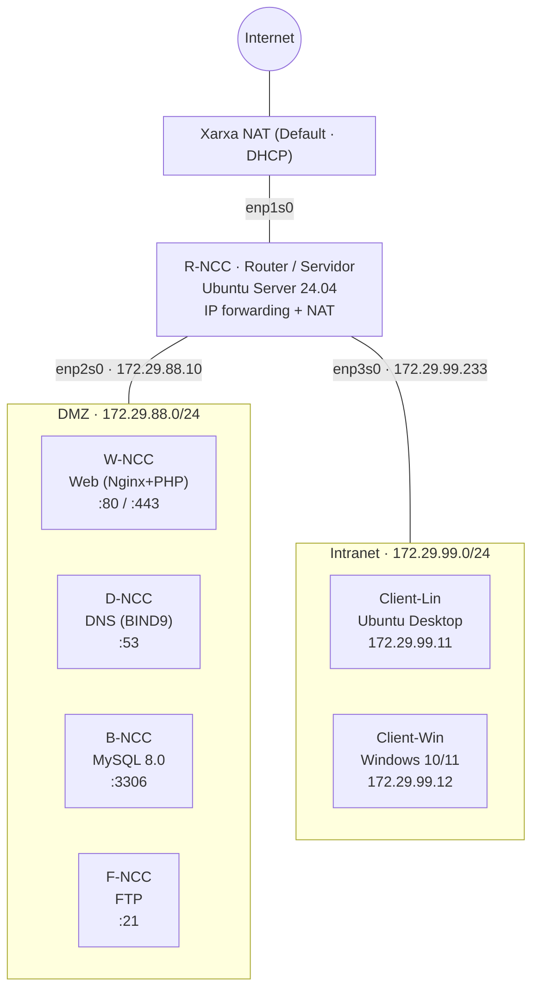

# 🗺️ Arquitectura de la infraestructura

> Diagrama de xarxa, adreçament IP i rol de cada equip.
> Per al procediment de creació de les VMs i la configuració pas a pas, vegeu [MVP_sprint1_infraestructura-config.md](MVP_sprint1_infraestructura-config.md).

## Índex

1. [Xarxes](#1-xarxes)
2. [Diagrama de xarxa](#2-diagrama-de-xarxa)
3. [Inventari d'equips](#3-inventari-dequips)
4. [Taula d'adreçament IP](#4-taula-dadreçament-ip)
5. [Fluxos de trànsit](#5-fluxos-de-trànsit)

---

## 1. Xarxes

El router `R-NCC` connecta tres xarxes:

| Xarxa | Xarxa IsardVDI | Subxarxa | Interfície router | Funció |
| :--- | :--- | :--- | :--- | :--- |
| **NAT** | `Default` | DHCP d'IsardVDI | `enp1s0` | Sortida a Internet |
| **DMZ** | `ASIXc2-ITB2` | `172.29.88.0/24` | `enp2s0` → `172.29.88.10` | Serveis accessibles (Web, DNS, BBDD, FTP) |
| **Intranet** | `ASIXc2-ITB3` | `172.29.99.0/24` | `enp3s0` → `172.29.99.233` | Clients interns |

## 2. Diagrama de xarxa



> ℹ️ GitHub renderitza els diagrames `mermaid` automàticament. Versió en text:

```text
                         Internet
                            │
                   Xarxa NAT (Default)
                            │ enp1s0 (DHCP)
              ┌─────────────┴──────────────┐
              │   R-NCC  Router / Servidor │
              │   Docker: D / W / B / F    │
              │   SSH · DHCP · NAT         │
              └──────┬──────────────┬──────┘
               enp2s0│              │enp3s0
           172.29.88.10/24     172.29.99.233/24
                     │              │
          ┌──────────┴───┐    ┌─────┴────────────────┐
          │     DMZ      │    │       Intranet       │
          │ W  D  B  F   │    │ Client-Lin Client-Win│
          └──────────────┘    │ .11        .12       │
                              └──────────────────────┘
```

## 3. Inventari d'equips

| Hostname | Tipus | SO / Imatge | Recursos | Xarxes | Serveis |
| :--- | :--- | :--- | :--- | :--- | :--- |
| `R-NCC` | VM | Ubuntu Server 24.04 | 3 vCPU · 6 GB RAM | NAT, DMZ, Intranet | Enrutament, NAT, SSH, DHCP, Docker |
| `W-NCC` | Contenidor | `richarvey/nginx-php-fpm` | — | DMZ | Web + aplicació de consulta |
| `D-NCC` | Contenidor | `internetsystemsconsortium/bind9:9.18` | — | DMZ | DNS |
| `B-NCC` | Contenidor | `mysql:8.0` | — | DMZ | Base de dades |
| `F-NCC` | Contenidor | `delfer/alpine-ftp-server` | — | DMZ | FTP |
| `Client-Lin` | VM | Ubuntu 24.04 Desktop | 1 vCPU · 4 GB RAM | Intranet | Client |
| `Client-Win` | VM | Windows 10/11 | 1 vCPU · 4 GB RAM | Intranet | Client |

> En aquesta fase (MVP), els serveis de la DMZ s'executen com a contenidors Docker a la mateixa VM `R-NCC` i publiquen els ports a la IP `172.29.88.10`.

## 4. Taula d'adreçament IP

| Equip | Interfície | Xarxa | Adreça IP | Gateway | DNS |
| :--- | :--- | :--- | :--- | :--- | :--- |
| `R-NCC` | `enp1s0` | NAT | DHCP | DHCP | — |
| | `enp2s0` | DMZ | `172.29.88.10/24` | — | `127.0.0.1` |
| | `enp3s0` | Intranet | `172.29.99.233/24` | — | `127.0.0.1` |
| `Client-Lin` | `enp2s0` | Intranet | `172.29.99.11/24` | `172.29.99.233` | `172.29.88.10` |
| `Client-Win` | `Ethernet` | Intranet | `172.29.99.12/24` | `172.29.99.233` | `172.29.88.10` |
| Rang DHCP | — | Intranet | `172.29.99.100` – `172.29.99.200` | `172.29.99.233` | `172.29.88.10` |

### Noms DNS (zona `asix.local`)

| Nom | Tipus | Valor |
| :--- | :--- | :--- |
| `r.asix.local` | A | `172.29.99.233` |
| `r-ncc.asix.local` | A | `172.29.99.233` |
| `w-ncc.asix.local` | A | `172.29.88.10` |
| `s-ncc.asix.local` | A | `172.29.88.10` |
| `b-ncc.asix.local` | A | `172.29.88.10` |
| `f-ncc.asix.local` | A | `172.29.88.10` |
| `d-ncc.asix.local` | A | `172.29.88.10` |

## 5. Fluxos de trànsit

| Origen | Destí | Port | Permès | Comentari |
| :--- | :--- | :--- | :-: | :--- |
| Intranet | DMZ (Web) | 80, 443/tcp | ✅ | Accés a l'aplicació web |
| Intranet | DMZ (DNS) | 53/tcp, 53/udp | ✅ | Resolució de noms |
| Intranet | DMZ (FTP) | 21, 21000-21010/tcp | ✅ | Transferència de fitxers |
| Intranet | `R-NCC` (SSH) | 22/tcp | ✅ | Administració |
| Intranet | Internet | tots | ✅ | Via NAT (`MASQUERADE` a `enp1s0`) |
| Intranet | DMZ (MySQL) | 3306/tcp | ⚠️ | Només des de l'equip d'administració |
| DMZ | Intranet | tots | ❌ | La DMZ no pot iniciar connexions cap a la Intranet |
