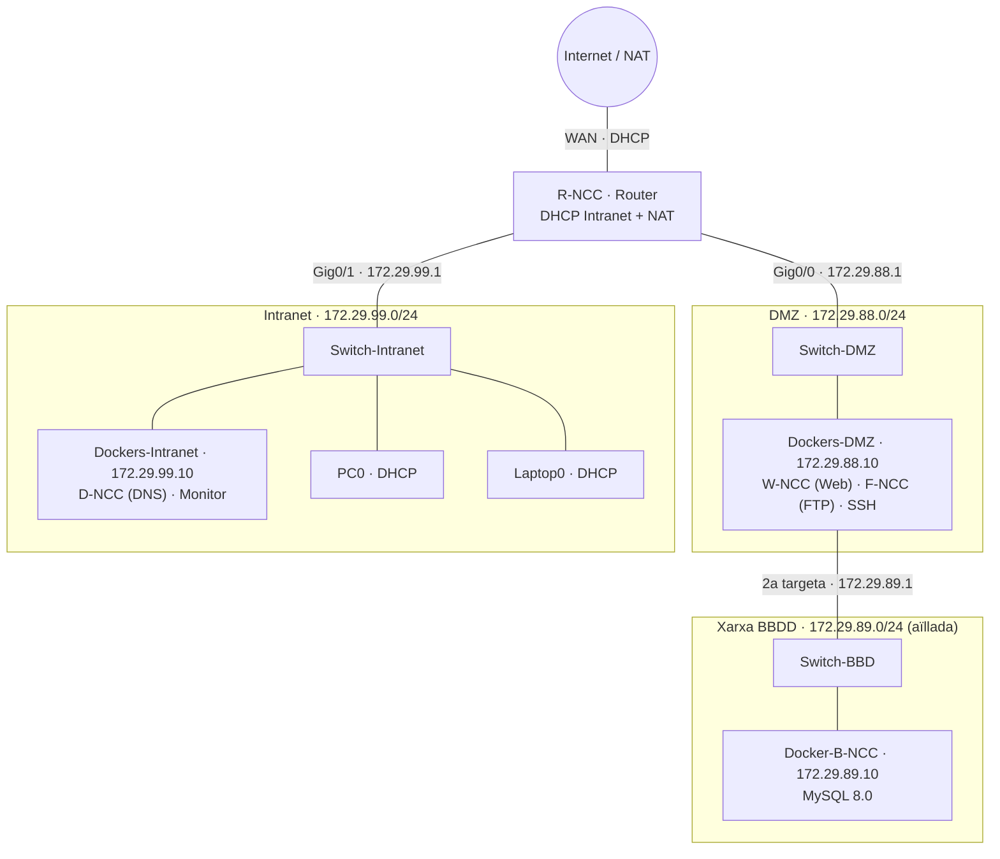

# 🗺️ Arquitectura de la infraestructura

> Mapa de xarxa, adreçament IP, rol de cada equip i **justificació de les decisions** que hem pres com a grup.
> El MVP del Sprint 1 (tot en una sola VM) es descriu a [MVP_sprint1_infraestructura-config.md](MVP_sprint1_infraestructura-config.md). Aquest document és l'arquitectura **final** cap a on anem.

## Índex

1. [Mapa de xarxa](#1-mapa-de-xarxa)
2. [Xarxes](#2-xarxes)
3. [Inventari d'equips](#3-inventari-dequips)
4. [Taula d'adreçament IP](#4-taula-dadreçament-ip)
5. [Noms DNS](#5-noms-dns)
6. [Fluxos de trànsit permesos](#6-fluxos-de-trànsit-permesos)
7. [Justificació de les decisions](#7-justificació-de-les-decisions)
8. [Configuració del router a Packet Tracer](#8-configuració-del-router-a-packet-tracer)

---

## 1. Mapa de xarxa

Disseny fet amb **Cisco Packet Tracer**:


Versió esquemàtica (inclou la xarxa de la BBDD, que proposem a la [secció 7.4](#74-la-base-de-dades-en-una-xarxa-a-part)):



## 2. Xarxes

| Xarxa | Subxarxa | Porta d'enllaç | Què hi ha | Qui hi pot entrar |
| :--- | :--- | :--- | :--- | :--- |
| **NAT / WAN** | DHCP del proveïdor (IsardVDI `Default`) | — | Sortida a Internet | — |
| **DMZ** | `172.29.88.0/24` | `172.29.88.1` (R-NCC) | Serveis que ha de veure tothom: Web, FTP, SSH | Intranet i (si calgués) Internet |
| **Intranet** | `172.29.99.0/24` | `172.29.99.1` (R-NCC) | Clients i serveis interns: DNS, monitor | Només la mateixa Intranet |
| **BBDD** | `172.29.89.0/24` *(proposta)* | **cap** (no està enrutada) | Servidor MySQL | Només el servidor `Dockers-DMZ` |

## 3. Inventari d'equips

| Equip (Packet Tracer) | Hostname / serveis | Xarxa | Configuració IP |
| :--- | :--- | :--- | :--- |
| Router 2911 | `R-NCC` | WAN, DMZ, Intranet | Estàtica (DHCP a la WAN) |
| Switch 2960 `Switch-DMZ` | — | DMZ | — |
| Switch 2960 `Switch-Intranet` | — | Intranet | — |
| Switch 2960 `Switch-BBD` | — | BBDD | — |
| Server `Dockers-DMZ` | `W-NCC` (Web), `F-NCC` (FTP), SSH | DMZ + BBDD | Estàtica |
| Server `Docker-B-NCC` | `B-NCC` (MySQL) | BBDD | Estàtica |
| Server `Dockers-Intranet` | `D-NCC` (DNS), Monitor de xarxa | Intranet | Estàtica |
| PC `PC0` | Client Windows | Intranet | DHCP |
| Laptop `Laptop0` | Client Linux | Intranet | DHCP |

> A IsardVDI cada "Server" és una VM Ubuntu Server 24.04 amb els serveis en contenidors Docker, i els clients són una VM Windows i una VM Ubuntu Desktop.

## 4. Taula d'adreçament IP

| Equip | Interfície | Adreça IP | Porta d'enllaç | DNS |
| :--- | :--- | :--- | :--- | :--- |
| `R-NCC` | WAN (cap al núvol) | DHCP | DHCP | DHCP |
| | `Gig0/0` (DMZ) | `172.29.88.1/24` | — | `172.29.99.10` |
| | `Gig0/1` (Intranet) | `172.29.99.1/24` | — | `172.29.99.10` |
| `Dockers-DMZ` | `Fa0` (DMZ) | `172.29.88.10/24` | `172.29.88.1` | `172.29.99.10` |
| | 2a targeta (BBDD) | `172.29.89.1/24` *(proposta)* | — | — |
| `Docker-B-NCC` | `Fa0` (BBDD) | `172.29.89.10/24` *(proposta)* | — | — |
| `Dockers-Intranet` | `Fa0` | `172.29.99.10/24` | `172.29.99.1` | `127.0.0.1` |
| `PC0` | `Fa0` | DHCP (`172.29.99.100` – `.200`) | `172.29.99.1` | `172.29.99.10` |
| `Laptop0` | `Fa0` | DHCP (mateix rang) | `172.29.99.1` | `172.29.99.10` |

**Reserva d'adreces a la Intranet:**

| Rang | Ús |
| :--- | :--- |
| `.1` | Router |
| `.2` – `.99` | Servidors i equips amb IP fixa |
| `.100` – `.200` | Rang DHCP per als clients |
| `.201` – `.254` | Lliure (ampliacions) |

## 5. Noms DNS

Zona `asix.local`, servida per `D-NCC` (`172.29.99.10`).

| Nom | Tipus | Valor |
| :--- | :--- | :--- |
| `r` | A | `172.29.99.1` |
| `r-ncc` | A | `172.29.99.1` |
| `w-ncc` | A | `172.29.88.10` |
| `f-ncc` | A | `172.29.88.10` |
| `d-ncc` | A | `172.29.99.10` |
| `monitor` | A | `172.29.99.10` |
| `b-ncc` | A | `172.29.89.10` *(només s'hi arriba des de la DMZ)* |

## 6. Fluxos de trànsit permesos

La regla general és: **la Intranet pot anar a la DMZ, però la DMZ no pot entrar a la Intranet**.

| Origen | Destí | Port | Permès | Per què |
| :--- | :--- | :--- | :-: | :--- |
| Intranet | DMZ (`W-NCC`) | 80, 443/tcp | ✅ | Veure l'aplicació web |
| Intranet | DMZ (`F-NCC`) | 21, 21000-21010/tcp | ✅ | Pujar i baixar fitxers |
| Intranet | DMZ (SSH) | 22/tcp | ✅ | Administrar el servidor |
| Intranet / DMZ | Internet | tots | ✅ | Sortida per NAT al router |
| DMZ | Intranet (`D-NCC`) | 53/udp+tcp | ⚠️ | **Única excepció**: els servidors de la DMZ fan servir el DNS intern |
| DMZ | Intranet | la resta | ❌ | Si ataquen la web, no han de poder saltar a la Intranet |
| `Dockers-DMZ` | BBDD (`B-NCC`) | 3306/tcp | ✅ | La web llegeix les dades |
| Intranet / Internet | BBDD | tots | ❌ | La BBDD no està enrutada: no hi ha cap camí |

## 7. Justificació de les decisions

Aquí expliquem **per què** hem muntat la xarxa així. Som estudiants, i moltes decisions les hem pres pensant en què és més fàcil d'entendre, de mantenir i de defensar, no només en què és "el més professional".

### 7.1 Tres xarxes separades (DMZ, Intranet i NAT)

L'enunciat ens demana tres xarxes, però també té sentit:

- A la **DMZ** posem el que ha de ser accessible des de fora (la web i l'FTP). Són els serveis més exposats i, per tant, els que tenen més risc de ser atacats.
- A la **Intranet** hi ha els usuaris i els serveis interns. Si algú ataca un servidor de la DMZ, el router no el deixa passar cap a la Intranet.
- La xarxa **NAT** és la sortida a Internet. Amb NAT tots els equips surten amb una sola IP i des de fora no es veuen les adreces internes.

### 7.2 Un sol router que fa d'enrutador, DHCP i NAT

Hem centralitzat aquestes funcions al router `R-NCC` perquè és l'únic equip que toca totes les xarxes.

- **Avantatge:** menys màquines per configurar i un sol lloc on mirar si alguna cosa falla.
- **Inconvenient:** si cau el router, cau tot. En un projecte de classe ho acceptem; en una empresa hi posaríem un segon router.

### 7.3 DNS i monitor a la Intranet

El DNS i el monitor són serveis **interns**: només els fan servir els nostres equips. No té sentit exposar-los a la DMZ.

- El **monitor** ha de poder vigilar totes les xarxes. Des de la Intranet pot arribar a la DMZ, però des de la DMZ no podria arribar a la Intranet.
- Com que els servidors de la DMZ també necessiten resoldre noms, obrim **només el port 53** de la DMZ cap a `172.29.99.10`. És una excepció petita i controlada. Una alternativa seria que la DMZ fes servir un DNS públic (`8.8.8.8`), però llavors no resoldria els noms interns (`asix.local`).

### 7.4 La base de dades en una xarxa a part

Vam dubtar entre posar la BBDD a la Intranet o a la DMZ. Al final la posem en una **xarxa pròpia, penjada només del servidor web** (`Switch-BBD`):

| Opció | Problema |
| :--- | :--- |
| BBDD a la **Intranet** | La web (DMZ) hauria de connectar-se a la Intranet. Això vol dir obrir un forat DMZ → Intranet, i si ataquen la web l'atacant ja tindria un camí cap a dins. Justament el que vol evitar la DMZ. |
| BBDD a la **DMZ**, al costat de la web | Tothom qui arriba a la DMZ podria intentar connectar-se al port 3306. |
| ✅ BBDD en una **xarxa aïllada** darrere la web | Només el servidor web hi té connexió. La xarxa no està connectada al router, així que des de la Intranet o des d'Internet no hi ha cap ruta per arribar-hi. |

Mesures que hi afegim:

- **Sense porta d'enllaç:** el servidor MySQL no té ruta per sortir de la seva xarxa.
- **Usuaris de MySQL limitats per IP:** l'aplicació es connecta amb un usuari que només pot entrar des de `172.29.89.1` i que **només té permís de lectura** (`SELECT`). Si algú ataqués la web, podria llegir les dades, però no esborrar-les ni modificar-les.
- **Accés d'administració per SSH:** per gestionar la BBDD primer entrem per SSH al servidor de la DMZ i, des d'allà, al MySQL. Així mai s'exposa el port 3306.

> 💡 **Què vam aprendre:** al principi pensàvem que tenir la BBDD a la Intranet faria la web més lenta i ens obligaria a xifrar les dades. En realitat el retard seria mínim (tot passa pel mateix router) i el xifratge no ve de la ubicació. El motiu de pes és la **seguretat**: no volem cap connexió que vagi de la DMZ cap a la Intranet.

### 7.5 IP fixa per als servidors, DHCP per als clients

- Els **servidors** tenen IP fixa perquè els altres equips i el DNS els han de trobar sempre a la mateixa adreça.
- Els **clients** reben la IP per DHCP. Si afegim un portàtil nou, funciona sense haver de configurar res a mà.
- Hem separat els rangs (servidors per sota de `.100`, DHCP de `.100` a `.200`) per evitar el conflicte d'IPs que vam tenir al Sprint 1.

### 7.6 Serveis en contenidors Docker

Cada servidor és una VM Ubuntu Server amb els serveis en **Docker**:

- Tota la configuració queda en fitxers (`docker-compose.yml`) que podem guardar a GitHub. Si una VM es trenca, la refem en minuts.
- Cada servei està aïllat dels altres: si un falla, no afecta la resta.
- Tots els membres del grup despleguen exactament el mateix, sense el típic "a mi em funciona".
- **Inconvenient:** hem hagut d'aprendre Docker, i alguns problemes (com el port 53 ocupat per `systemd-resolved`) són més difícils de diagnosticar.

### 7.7 Rangs d'IP

Fem servir les xarxes `172.29.x.0/24` que ens assigna l'entorn de l'escola. Les màscares `/24` (254 equips) són més que suficients i fàcils de recordar.

## 8. Configuració del router a Packet Tracer

```text
enable
configure terminal
hostname R-NCC

interface GigabitEthernet0/0
 description DMZ
 ip address 172.29.88.1 255.255.255.0
 no shutdown

interface GigabitEthernet0/1
 description Intranet
 ip address 172.29.99.1 255.255.255.0
 no shutdown

ip dhcp excluded-address 172.29.99.1 172.29.99.99
ip dhcp excluded-address 172.29.99.201 172.29.99.254
ip dhcp pool INTRANET
 network 172.29.99.0 255.255.255.0
 default-router 172.29.99.1
 dns-server 172.29.99.10
 domain-name asix.local

ip domain-lookup
ip name-server 172.29.99.10
end
write memory
```

Comprovació:

```text
show ip interface brief
show ip dhcp binding
```
