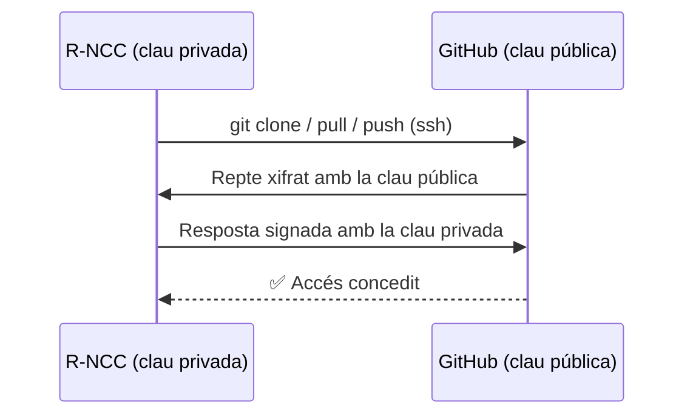

# 🌿 Control de versions i pujades a producció

> Procediment Git de l'equip: autenticació per clau SSH, ordres bàsiques, convencions i desplegament a producció.

## Índex

1. [Repositori](#1-repositori)
2. [Autenticació amb clau SSH](#2-autenticació-amb-clau-ssh)
3. [Ordres bàsiques](#3-ordres-bàsiques)
4. [Flux de treball de l'equip](#4-flux-de-treball-de-lequip)
5. [Convenció de missatges de commit](#5-convenció-de-missatges-de-commit)
6. [Pujada a producció](#6-pujada-a-producció)
7. [Què NO s'ha de pujar](#7-què-no-sha-de-pujar)
8. [Resolució de problemes](#8-resolució-de-problemes)

---

## 1. Repositori

| Camp | Valor |
| :--- | :--- |
| Nom | `P0.0-ASIXc2B-G07` |
| Plataforma | GitHub |
| URL SSH | `git@github.com:ITB2526-DidacVazquez/P0.0-ASIXc2B-G07-.git` |
| URL HTTPS | `https://github.com/ITB2526-DidacVazquez/P0.0-ASIXc2B-G07-.git` |
| Branca de producció | `main` |

## 2. Autenticació amb clau SSH

El servidor `R-NCC` s'autentica contra GitHub amb un **parell de claus pública/privada**: la clau privada es queda al servidor i la pública es registra a GitHub.



### 2.1 Generar el parell de claus

```bash
ssh-keygen -t ed25519 -C "R-NCC@P0.0-ASIXc2B-G07"
# Prem Enter per acceptar la ruta per defecte (~/.ssh/id_ed25519)

ls ~/.ssh/
# id_ed25519      → clau PRIVADA (no es comparteix mai)
# id_ed25519.pub  → clau PÚBLICA (es puja a GitHub)
```

### 2.2 Registrar la clau pública a GitHub

```bash
cat ~/.ssh/id_ed25519.pub
```

Copia tota la línia i afegeix-la a GitHub:

- **Per a un usuari:** *Settings → SSH and GPG keys → New SSH key*.
- **Només per al servidor (recomanat):** al repositori, *Settings → Deploy keys → Add deploy key* (marca *Allow write access* si el servidor ha de fer `push`).

### 2.3 Provar la connexió

```bash
ssh -T git@github.com
# Hi ITB2526-DidacVazquez/P0.0-ASIXc2B-G07-! You've successfully authenticated...
```

### 2.4 Canviar un repositori existent de HTTPS a SSH

```bash
git remote -v
git remote set-url origin git@github.com:ITB2526-DidacVazquez/P0.0-ASIXc2B-G07-.git
```

## 3. Ordres bàsiques

| Ordre | Funció | Exemple |
| :--- | :--- | :--- |
| `git clone` | Descarrega el repositori per primer cop | `git clone git@github.com:ITB2526-DidacVazquez/P0.0-ASIXc2B-G07-.git` |
| `git status` | Mostra els canvis pendents | `git status` |
| `git add` | Afegeix canvis a l'àrea de preparació (*staging*) | `git add docs/02-admin/serveis.md` · `git add .` |
| `git commit -m` | Desa els canvis preparats amb un missatge | `git commit -m "docs: afegir configuració DNS"` |
| `git push` | Puja els commits locals a GitHub | `git push origin main` |
| `git pull` | Baixa i integra els canvis de GitHub | `git pull origin main` |
| `git log` | Historial de commits | `git log --oneline --graph` |
| `git diff` | Mostra les diferències no preparades | `git diff` |

### Cicle habitual

```bash
git pull origin main                       # 1. Actualitza abans de començar
# ... editar fitxers ...
git status                                 # 2. Revisa què ha canviat
git add .                                  # 3. Prepara els canvis
git commit -m "feat: afegir zona DNS"      # 4. Desa'ls amb un missatge clar
git push origin main                       # 5. Puja'ls a GitHub
```

## 4. Flux de treball de l'equip

- `main` és la branca **estable / producció**: el que hi ha a `main` és el que s'executa al servidor.
- Cada tasca del ProofHub es fa en una **branca pròpia** i s'integra amb un *Pull Request*:

```bash
git checkout -b feature/dns-zona
# ... canvis + commits ...
git push -u origin feature/dns-zona
# A GitHub: obrir Pull Request → revisió d'un company → Merge a main
```

| Prefix de branca | Ús |
| :--- | :--- |
| `feature/` | Nova funcionalitat o servei |
| `fix/` | Correcció d'errors |
| `docs/` | Només documentació |

## 5. Convenció de missatges de commit

Format: `tipus: descripció breu en imperatiu`

| Tipus | Quan s'utilitza | Exemple |
| :--- | :--- | :--- |
| `feat` | Nou servei o funcionalitat | `feat: afegir servei FTP` |
| `fix` | Correcció | `fix: corregir IP del gateway al client Linux` |
| `docs` | Documentació | `docs: completar pla de proves` |
| `config` | Fitxers de configuració | `config: afegir volum persistent a MySQL` |
| `structure` | Estructura de carpetes | `structure: crear carpeta src/dns` |

## 6. Pujada a producció

El servidor `R-NCC` té una còpia del repositori clonada per SSH. Desplegar és **baixar l'última versió de `main` i recrear els contenidors**:

```bash
# Primer desplegament
cd /home/isard
git clone git@github.com:ITB2526-DidacVazquez/P0.0-ASIXc2B-G07-.git proyecto-p00
cd proyecto-p00/src
cp .env.example .env && nano .env           # posar les contrasenyes reals
sudo docker compose up -d

# Actualitzacions
cd /home/isard/proyecto-p00
git pull origin main
cd src
sudo docker compose up -d                   # recrea només els serveis que han canviat
sudo docker compose ps
```

> ✅ Abans de fer `git pull` a producció, comprova que el canvi s'ha provat i que el *Pull Request* està aprovat.

## 7. Què NO s'ha de pujar

Fitxer `.gitignore` a l'arrel del repositori:

```gitignore
# Secrets
.env
*.pem
id_*

# Dades pesades o generades
*.csv
*.log
```

> ⚠️ Mai pugis claus privades, el fitxer `.env` ni *tokens* de GitHub. Si es puja un secret per error, cal **revocar-lo** immediatament: esborrar-lo en un commit nou no l'elimina de l'historial.

## 8. Resolució de problemes

| Error | Causa probable | Solució |
| :--- | :--- | :--- |
| `Permission denied (publickey)` | La clau pública no està a GitHub o no es fa servir la clau correcta | Revisa §2.2 i prova `ssh -vT git@github.com` |
| `No user exists for uid ...` | L'usuari de la sessió (LDAP de l'escola) no existeix a `/etc/passwd`, i `ssh` no troba el seu `HOME` | Treballa amb un usuari local del servidor (`isard` o `bchecker`) o, temporalment, amb HTTPS + *Personal Access Token* |
| `! [rejected] main -> main (fetch first)` | Hi ha commits a GitHub que no tens en local | `git pull origin main`, resol conflictes i torna a fer `push` |
| `CONFLICT (content)` | Dues persones han modificat les mateixes línies | Edita el fitxer, tria el contingut correcte, `git add` i `git commit` |
